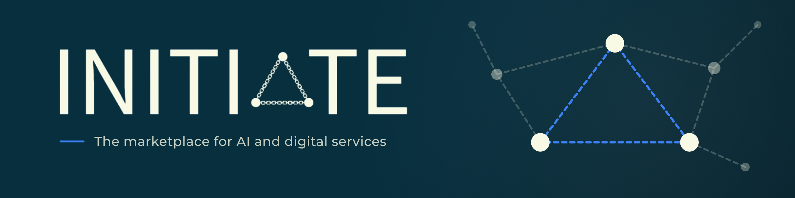

---

Initiate is an AI-assisted marketplace where small and medium-sized enterprises find, compare, buy, and manage AI and digital services from solution providers. Buyers start from a business need, narrow the options with semantic search and an AI advisor, then carry the match through messaging, ordering, and delivery in one place.

It is a TanStack Start app with a Hono API, deployed as a single Cloudflare Worker backed by D1, R2, Vectorize, Queues, Durable Objects, and Workflows.

## Features

- **Marketplace**: Search services by keyword or meaning, get recommendations, and compare up to five services.
- **AI Advisor**: Chat with an assistant that summarizes options and sharpens problem statements.
- **Service Catalog**: Publish organization profiles and API, MCP, SaaS, or custom services with plans and pricing.
- **Orders**: Track orders through milestones, invoices, payments, and refunds.
- **Messaging and Calls**: Message, share attachments, and hold voice or video calls in personal and organization rooms.
- **Community**: Post problems, follow topics, comment, and send or accept proposals.
- **Resources**: Browse grants and documentation, with AI analysis of grant fit for an organization.
- **Provider Analytics**: Review revenue, order activity, top services, and AI insights.
- **Notifications**: Receive in-app and email notifications for orders and platform activity.

## Tech Stack

- [TanStack Start](https://tanstack.com/start/latest) with [React](https://react.dev) for routing, server rendering, and the user interface.
- [Hono](https://hono.dev) for the API routes.
- [Cloudflare Workers](https://developers.cloudflare.com/workers) for hosting, with D1, R2, Vectorize, Queues, Durable Objects, Workflows, Email, and RealtimeKit.
- [Drizzle ORM](https://orm.drizzle.team) for the D1 schema, queries, and migrations.
- [Better Auth](https://www.better-auth.com) for authentication.
- [AI SDK](https://ai-sdk.dev) with [OpenRouter](https://openrouter.ai) for the advisor, summaries, and embeddings.
- [shadcn/ui](https://ui.shadcn.com) on [Radix UI](https://www.radix-ui.com) and [Tailwind CSS](https://tailwindcss.com) for components and styling.
- [Bun](https://bun.sh) for dependencies, linting, formatting, type checking, and tests.

## Getting Started

### Prerequisites

- [Bun](https://bun.sh) 1.4 or newer
- [Node.js](https://nodejs.org) 22.18 or newer
- [Just](https://just.systems)

### Setup

1. Copy `.env.template` to `.env` and fill in the keys.

   ```sh
   cp .env.template .env
   ```

2. Install dependencies and apply the local database migrations.

   ```sh
   just setup
   ```

3. Start the development server and open http://localhost:3000.

   ```sh
   just start
   ```

## Documentation

- [Cloudflare Development](docs/guides/cloudflare.md)

## License

Licensed under the [MIT License](LICENSE).
